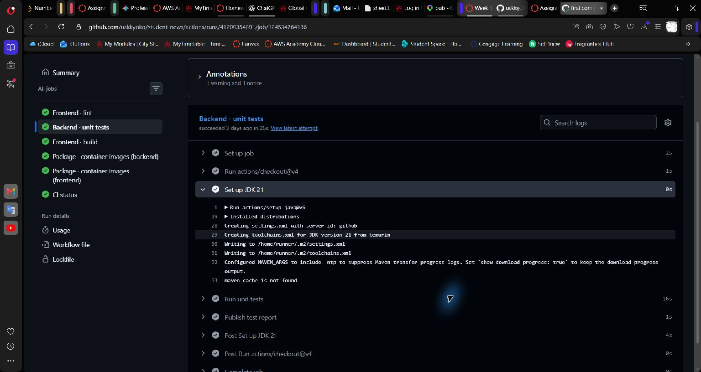
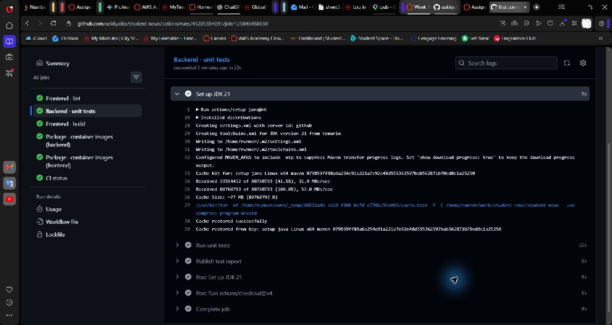
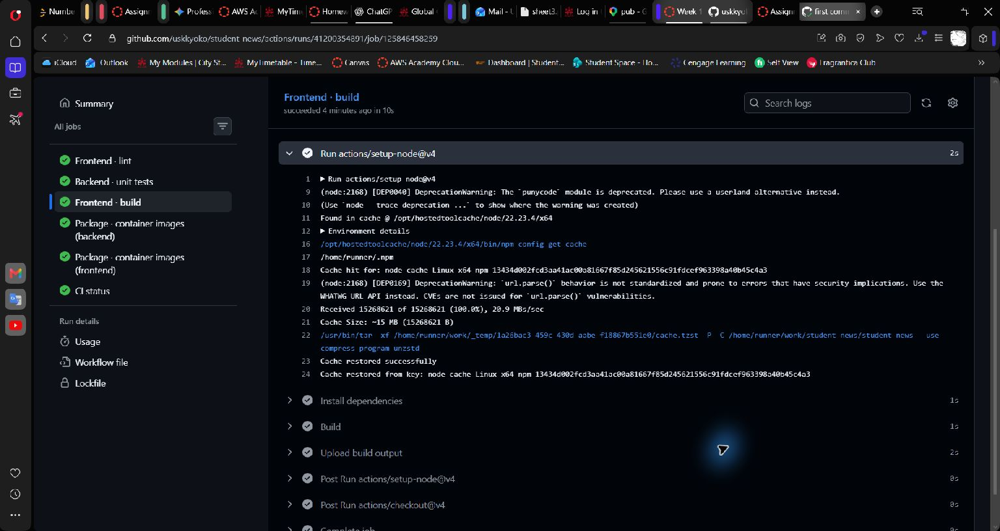

# Task 2 — Make it fast

## 2.1 Node build matrix

The `frontend-build` job in `.github/workflows/ci.yml` now uses:

```yaml
strategy:
  fail-fast: false
  matrix:
    node: [20, 22]
```

`setup-node` uses `node-version: ${{ matrix.node }}`. Build artifacts are named `frontend-dist-node${{ matrix.node }}`.

The optional manual input `fail_node20` deliberately exits the Node 20 build with code 1. It defaults to false, so regular pushes and pull requests build normally.

In [demonstration run #6](https://github.com/uskkyoko/student-news/actions/runs/41615131486), Node 20 failed intentionally, while Node 22 completed its build and artifact upload. Node 22 was not cancelled because `fail-fast: false` lets matrix siblings continue. The overall workflow failed, and packaging was skipped because it depends on successful builds.


The subsequent [normal run #7](https://github.com/uskkyoko/student-news/actions/runs/41615459934) passed all jobs, including both Node versions, integration tests, container packaging, and CI status. Both `frontend-dist-node20` and `frontend-dist-node22` artifacts were uploaded.

## 2.2 Cache measurement

Compared [attempt 1](https://github.com/uskkyoko/student-news/actions/runs/41200354891/attempts/1) with [attempt 2](https://github.com/uskkyoko/student-news/actions/runs/41200354891/attempts/2) of CI run #1 at the same commit, `72fa3717c83319e6c776dd684b696556ec36bfe2`. The first attempt ran on October 31, 2026; the identical workflow was rerun on November 3, 2026.

| Cache / measured step | Cold | Warm | Saving |
| --- | ---: | ---: | ---: |
| npm: frontend `Install dependencies` (`npm ci`) | 3 seconds | 1 second | **2 seconds** |
| Maven: backend `Run unit tests` (`mvn -B test ...`) | 16 seconds | 12 seconds | **4 seconds** |

Durations are the step durations displayed by GitHub Actions, also checked against its jobs API. Savings are cold duration minus warm duration.

The cold logs explicitly say `npm cache is not found` and `maven cache is not found`. Warm logs show exact-key cache hits and `Cache restored successfully` for both. Node's preinstalled runtime cache is separate from the npm dependency cache.

The cold attempt was the fork's initial CI cache population, rather than a verified dependency-change run. The existing workflow resolves Maven dependencies inside `Run unit tests`; therefore its 16s/12s figures include dependency resolution, compilation, and testing, not dependency downloads alone. Cache setup/restore and save overhead are outside the measured steps. This is one observed comparison, not a controlled benchmark or a guaranteed saving.

### Maven cold

[Original job](https://github.com/uskkyoko/student-news/actions/runs/41200354891/job/124534764136)



### Maven warm

[Rerun job](https://github.com/uskkyoko/student-news/actions/runs/41200354891/job/125846458850)



### npm cold

[Original job](https://github.com/uskkyoko/student-news/actions/runs/41200354891/job/124534764041)


### npm warm

[Rerun job](https://github.com/uskkyoko/student-news/actions/runs/41200354891/job/125846458259)


